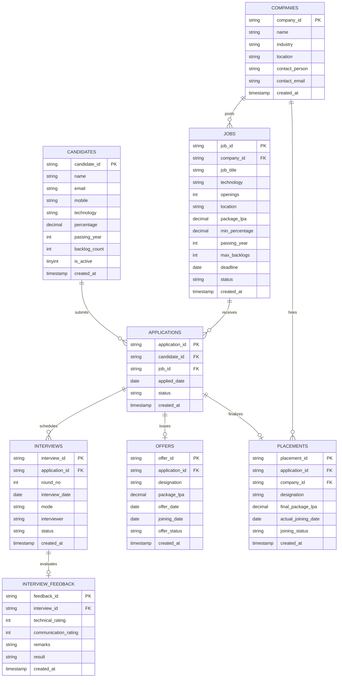

# TalentLoop - Entity Relationship Diagram

This document describes the relational architecture of the `talentloop_db` database for the TalentLoop Recruitment & Placement Management System.

---

### Entity Relationship Diagram

---

### Relationship Explanations

#### 1. Companies to Jobs (One-to-Many: `1 : N`)
A registered company can post multiple job vacancies across different technology domains and eligibility profiles over time. Each job vacancy record is associated with exactly one hiring company via `company_id`. When a company profile is removed or updated, foreign key constraints handle cascading appropriately.

#### 2. Candidates to Applications (One-to-Many: `1 : N`)
A student or job seeker profile in the `candidates` table may apply for zero, one, or multiple open jobs, provided they meet the requisite criteria. Each row in the `applications` table references exactly one candidate via `candidate_id`. A unique composite index on `(candidate_id, job_id)` prevents a candidate from submitting duplicate applications for the same opening.

#### 3. Jobs to Applications (One-to-Many: `1 : N`)
Each job opening posted by an employer can attract applications from multiple qualified candidates. Each individual application record is tied to exactly one specific job posting via `job_id`. When a job posting closes, existing applications remain preserved for reporting and audit history.

#### 4. Applications to Interviews (One-to-Many: `1 : N`)
An application that advances past screening into the interview stage can encompass multiple successive evaluation rounds (for example, Round 1 Technical, Round 2 Coding, Round 3 Managerial/HR). Each interview record is linked to a single application via `application_id` and tracks the round number, scheduled date, interview mode (Online or Offline), interviewer name, and execution status.

#### 5. Interviews to Interview Feedback (One-to-One: `1 : 1`)
For every interview session completed, the evaluating interviewer submits exactly one structured assessment record containing numerical scores for technical competence (1 to 10), communication skills (1 to 10), detailed remarks, and an overall outcome result (`PASS` or `FAIL`). Linking is maintained via `interview_id`. Feedback can only be entered once per interview session.

#### 6. Applications to Offers (One-to-One: `1 : 1`)
When a candidate successfully passes all required interview rounds and reaches the `SELECTED` stage, the hiring team issues a formal job offer. Each application may receive at most one formal offer record via `application_id`, specifying the designation, compensation package in LPA, issue date, and expected joining date. The offer record maintains its own lifecycle status (`OFFERED`, `ACCEPTED`, `DECLINED`).

#### 7. Applications to Placements (One-to-One: `1 : 1`)
Once an issued offer is marked as `ACCEPTED`, the placement cell records a confirmed student placement in the `placements` table. An application can have at most one placement record, uniquely identifying the finalized student placement, finalized package, and actual joining status. Recording this placement moves the application to `JOINED` and decrements available job vacancies.

#### 8. Companies to Placements (One-to-Many: `1 : N`)
Each finalized placement links directly to the employing company through `company_id`. While each placement represents one student hired by one specific company, a single hiring partner can employ multiple placed students across different recruitment drives. This allows company-level aggregation queries for hiring volume, average compensation, and package benchmarks.

